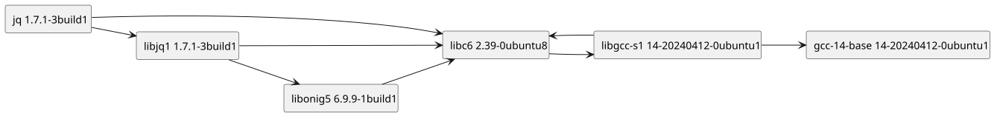

# Практическая работа №2. Зависимости пакетов Ubuntu

Комаров В.Ю., ИКБО-41-25, вариант 8.

Программа находит нужную версию пакета в индексе Ubuntu `Packages` и
показывает, какие пакеты ей нужны. Сначала проверяет прямые зависимости,
потом зависимости этих пакетов и так дальше. Это обход в ширину (BFS):
уже найденный пакет второй раз не обходим, поэтому на цикле программа не зависает.
Для работы без интернета есть примеры с пакетами `A`, `B`, `C` и `D`.

## Как запустить

Нужен Python 3.10 или новее. Устанавливать библиотеки через `pip` не нужно.
Из папки проекта:

```bash
python -X utf8 src/main.py examples/diamond.csv
python -X utf8 src/main.py examples/cycle.csv --load-order
python -X utf8 src/main.py examples/hello.csv
python -X utf8 -m unittest discover -s tests -v
```

Первая команда печатает граф, вторая показывает цикл и порядок после
пропуска обратного ребра, третья читает настоящий индекс Ubuntu.
В Windows можно использовать `run.bat`, в Linux и Git Bash — `./run.sh`.
Без аргументов запускается пример `diamond.csv`.

## Что менять в CSV

По одному параметру на строку: `ключ,значение`, без заголовка.
Нужны все семь строк. Относительные пути считаются от папки с CSV.

- `package` — имя пакета.
- `repository` — ссылка на индекс `Packages` (можно `.gz` или `.xz`)
  или путь к учебному файлу со строками вроде `A: B C`.
- `test_mode` — `true` для учебного файла, `false` для Ubuntu.
- `version` — точная версия пакета. Для учебного примера можно оставить `1.0`.
- `output` — куда записать файл `.svg`.
- `max_depth` — сколько уровней зависимостей смотреть (от 0 до 100).
- `exclude` — часть имени пакета, который надо пропустить.
  Можно оставить пустым, но строка в CSV нужна.

## Картинка и сравнение с APT

Для картинки нужны Java и [PlantUML](https://plantuml.com/download).
Положи `plantuml.jar` в папку запуска или укажи путь к нему в
`PLANTUML_JAR`. Команда ниже сохранит SVG и исходник `.puml` рядом:

```bash
python -X utf8 src/main.py examples/hello.csv --svg
```

Готовые графы для трёх пакетов:





Для графа программа читает только обязательные зависимости из индекса.
Прямые зависимости этих трёх пакетов совпали с выводом `apt-cache dotty`.
Порядок для `hello` совпал с симуляцией APT без установленных пакетов.
На обычной системе часть зависимостей уже есть, поэтому APT может их
пропустить. [Команды и результаты сравнения](docs/apt-comparison.md).

Пять этапов лежат в отдельных коммитах с тегами `stage-1`–`stage-5`:
CSV, чтение индекса, обход графа, порядок загрузки и картинка.
